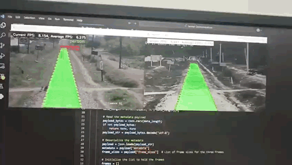
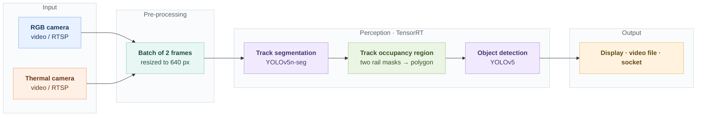
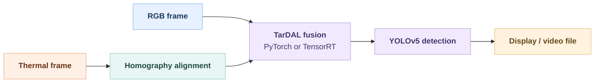

<div align="center">

# Saferail-AI

**Thermal + RGB perception for railway track monitoring and obstacle awareness on NVIDIA Jetson.**

[](https://www.python.org/)
[](https://pytorch.org/)
[](https://developer.nvidia.com/tensorrt)
[](https://developer.nvidia.com/embedded-computing)
[](#project-status-and-limitations)
[-blue?style=flat-square)](#publication)

[Overview](#overview) · [Demo](#demo) · [How it works](#how-it-works) · [Repository guide](#repository-guide) · [Getting started](#getting-started) · [Usage](#-usage) · [Model export](#model-export-and-tensorrt) · [Limitations](#project-status-and-limitations) · [Roadmap](#roadmap) · [Publication](#publication)

</div>

> [!IMPORTANT]
> **Research prototype, not a certified train-protection system.** Do not use its outputs as the sole basis for train operation, braking or any other safety-critical decision.

---

## Overview

Level crossings and track corridors are hard to monitor at night and in poor weather. Saferail-AI processes **paired visible-light (RGB) and thermal (IR) streams** to find the track area and detect objects on or near it, with all inference running through **TensorRT** on an **NVIDIA Jetson Orin Nano**.

**What it does**

- 🛤️ **Track segmentation**: a YOLOv5n-seg model segments the rails, and the two rail masks are joined into a track occupancy region.
- 🎯 **Object detection**: a YOLOv5 detector finds objects, and each is drawn against that track region.
- 🌡️ **Dual-stream processing**: the RGB and thermal frames are processed together as one batch of two, so the scene is covered in both modalities.
- 🔀 **Image fusion (experimental)**: an alternative path aligns the thermal frame to the RGB frame with a homography and fuses them with [TarDAL](https://github.com/faizan1234567/TarDAL) before detection.
- ⚡ **Edge deployment**: FP16/INT8 TensorRT engines, RTSP camera input and socket streaming of results.

---

## Demo

Saferail-AI running live on the optical (left) and thermal (right) streams: the track region is segmented in green, and a person on the track is flagged as an intrusion.

<p align="center">
  <a href="assets/saferail_project_demo.mp4">
    
  </a>
  <br>
  <sub>▶️ Click the animation to open the full-quality demo video.</sub>
</p>

---

## How it works

The main applications run **segmentation, then detection, on both streams in parallel**:



The fusion path in [`app.py`](app.py) instead combines the two streams into one image first:



---

## Repository guide

### Applications

- [`app_final.py`](app_final.py): **main entry point.** Track segmentation and detection on a pair of RGB and thermal videos or RTSP streams.
- [`app_final_rtsp.py`](app_final_rtsp.py): the same pipeline for live cameras, with a reader thread per stream. All settings come from [`configs/config.py`](configs/config.py).
- [`app_socket_final.py`](app_socket_final.py): runs the pipeline and streams the annotated frames to a client over TCP.
- [`app.py`](app.py): the experimental **fusion** pipeline (homography alignment, then TarDAL fusion, then detection).

### Models and perception

- [`track_roi.py`](track_roi.py): turns rail masks into a track occupancy polygon and tests whether a point lies inside it. Running it directly shows a small demo on random masks.
- [`JetsonYolov5/`](JetsonYolov5): TensorRT YOLOv5 detection wrapper (submodule), with its plugin build.
- [`detection_segmentation/`](detection_segmentation): TensorRT YOLOv5 segmentation wrapper for the track model (submodule).
- [`fusion/`](fusion): lightweight fusion networks (DenseFuse, RailFuse) and their building blocks.
- [`TarDAL/`](https://github.com/faizan1234567/TarDAL): infrared–visible image fusion, included as a Git submodule.
- [`registration_data/`](registration_data): camera calibration (`calib.npz`) and the thermal-to-RGB homography (`homography.npz`).

### Export and acceleration

- [`generate_onnx.py`](generate_onnx.py): exports a fusion model (`tardal`, `meta_fusion` or `dense_fuse`) to ONNX.
- [`int8_calibration/`](int8_calibration): builds FP16/INT8 TensorRT engines from ONNX with a min-max calibrator; includes calibration caches.
- [`run_trt_inference.py`](run_trt_inference.py): runs a fusion TensorRT engine over a folder of RGB/thermal image pairs.
- [`utils.py`](utils.py): ONNX export helper and a GStreamer RTSP server.

### Assets and configuration

- [`weights/`](weights): PyTorch checkpoints: [detection](weights/detection_weights/weights) (YOLOv5s, YOLOv5m, YOLO11s) and [track segmentation](weights/segmentation_weights/pt_weights) (YOLOv5n-seg). TensorRT engines are **not** included and must be built for your device.
- [`videos/`](videos): two paired RGB/thermal sample clips (`1_*`, `2_*`).
- [`configs/config.py`](configs/config.py): RTSP URLs, engine paths, plugin libraries and confidence threshold for the RTSP app.
- [`scripts/`](scripts): helper for building fusion dataset file lists.
- [`requirements.txt`](requirements.txt): base Python dependencies (see [Requirements](#requirements) for what it doesn't cover).

---

## Getting started

### Requirements

| | |
|---|---|
| **Hardware** | NVIDIA Jetson Orin Nano (any CUDA GPU works for development) |
| **Software** | JetPack with CUDA and TensorRT; Python 3.8 |
| **Python packages** | `requirements.txt`, plus a device-matched **PyTorch** build and `imutils`, `pycuda`, `onnx` |
| **INT8 calibration** | additionally `cuda-python` and NVIDIA `pytorch-quantization` |
| **RTSP server** (`utils.py`) | GStreamer with `gst-rtsp-server` Python bindings |
| **TensorRT YOLO wrappers** | the `JetsonYolov5` submodules with compiled `libmyplugins.so` (see the warning below) |

> [!WARNING]
> The TensorRT applications rely on two **YOLO wrapper submodules**: [`JetsonYolov5/`](JetsonYolov5) (detection, `YoloTRT`) and [`detection_segmentation/JetsonYolov5/`](detection_segmentation) (segmentation, `YoLov5TRT`). Each must contain a compiled `libmyplugins.so`, built on the device, before `app_final.py`, `app_final_rtsp.py` or `app_socket_final.py` will run.

There is no tested version matrix for JetPack, PyTorch, CUDA and TensorRT. Pick mutually compatible versions for your device. `requirements.txt` pins `torchvision==0.16.2`, which may need changing on Jetson.

### 1. Clone with submodules

```bash
git clone --recurse-submodules https://github.com/mfaizan-ai/Saferail-AI.git
cd Saferail-AI
```

For an existing clone, run `git submodule update --init --recursive`.

### 2. Set up Python

```bash
python3 -m venv .venv
source .venv/bin/activate
python -m pip install --upgrade pip
```

Install PyTorch for your hardware first, using the [PyTorch selector](https://pytorch.org/get-started/locally/) or [NVIDIA's Jetson instructions](https://docs.nvidia.com/deeplearning/frameworks/install-pytorch-jetson-platform/index.html). Then install the rest:

```bash
python -m pip install -r requirements.txt
python -m pip install imutils pycuda onnx
```

On Jetson, TensorRT's Python bindings come with JetPack. If you use a virtual environment, create it with `--system-site-packages` so it can see them.

### 3. Build the TensorRT engines

Engines are tied to the GPU and TensorRT version they were built on, so build them on the target device from the checkpoints in [`weights/`](weights):

1. **Detection**: a YOLOv5 engine (e.g. from `yolov5s` or `yolov5m`) plus its `libmyplugins.so`.
2. **Track segmentation**: a YOLOv5n-seg engine built for **batch size 2** (one RGB and one thermal frame).
3. **Fusion** (only for `app.py`): ONNX via [`generate_onnx.py`](generate_onnx.py), then an engine via [`int8_calibration/build_engine.py`](int8_calibration/build_engine.py).

---

## 🚀 Usage

### Paired RGB and thermal videos

```bash
python app_final.py \
  --source1 videos/1_optical.mp4 \
  --source2 videos/1_thermal.mp4 \
  --det_weights /path/to/detection.engine \
  --seg_weights /path/to/segmentation.engine \
  --conf 0.45
```

| Option | Default | Description |
|---|---|---|
| `--source1`, `--source2` | `video/optical.mp4`, `video/thermal.mp4` | RGB and thermal source: a file path or RTSP URL. **Always pass these**: the defaults point to a `video/` folder that doesn't exist. |
| `--det_weights` | `engine_files/yolov5m_rrlv2.engine` | Detection TensorRT engine |
| `--seg_weights` | `detection_segmentation/.../yolov5n-seg-...engine` | Segmentation TensorRT engine |
| `--conf` | `0.45` | Detection confidence threshold |
| `--yolo_ver` | `v5` | YOLO version expected by the detection wrapper |
| `--rtsp_source` | off | Resize frames to 640 × 360, for camera streams |
| `--save` | off | Write output to `videos/output.mp4` |

Two windows open, one per stream, each showing the frame rate. Press **`q`** to quit.

The plugin library paths are set inside the script (`detection_segmentation/JetsonYolov5/yolov5/build/libmyplugins.so` and `JetsonYolov5/yolov5/buildv1/libmyplugins.so`). Adjust them if yours are elsewhere.

### Live RTSP cameras

Set the camera URLs as environment variables (the defaults in [`configs/config.py`](configs/config.py) are placeholders), and edit `DETECTION_WEIGHTS`, `SEGMENTATION_WEIGHTS`, the two plugin libraries and `CONF` in that file. Then run:

```bash
export RTSP_URL_OPTICAL='rtsp://<username>:<password>@<camera-ip>:554/Streaming/Channels/101'
export RTSP_URL_THERMAL='rtsp://<username>:<password>@<camera-ip>:554/Streaming/Channels/201'
python app_final_rtsp.py
```

This script takes no command-line arguments. Each camera is read in its own thread, and it reconnects if a stream drops.

> [!CAUTION]
> **Never commit camera credentials.** Keep real RTSP URLs in environment variables, not in `configs/config.py`.

### Socket streaming

```bash
python app_socket_final.py \
  --source1 videos/1_optical.mp4 \
  --source2 videos/1_thermal.mp4 \
  --det_weights /path/to/detection.engine \
  --seg_weights /path/to/segmentation.engine
```

The script runs a TCP server and sends the annotated frames to a client once one connects. The host and port are set in the script (`HOST`, `PORT = 9999`), so change `HOST` to your device's address. It accepts the same `--conf`, `--yolo_ver`, `--batch_size` and `--save` options as `app_final.py`.

### Fusion pipeline (experimental)

```bash
python app.py \
  --video1 videos/1_optical.mp4 \
  --video2 videos/1_thermal.mp4 \
  --cfg TarDAL/config/default.yaml \
  --homography registration_data/homography.npz \
  --engine /path/to/tardal.engine \
  --fusion
```

Leave out `--engine` to run TarDAL in PyTorch, and add `--write` to save the output video. The detection engine and plugin paths are set inside the script.

### Track-region demo

```bash
python track_roi.py
```

This prints the occupancy regions built from random masks. It's a check of the geometry helpers, not a video tool.

---

## Model export and TensorRT

### Export a fusion model to ONNX

```bash
python generate_onnx.py \
  --cfg TarDAL/config/default.yaml \
  --weights /path/to/tardal-weights.pth \
  --model_name tardal          # or meta_fusion, dense_fuse
```

### Build an FP16 or INT8 engine

```bash
python int8_calibration/build_engine.py \
  --onnx /path/to/tardal.onnx \
  --engine /path/to/tardal.engine \
  --data /path/to/calibration-images \
  --cache int8_calibration/calib_files/tardal_int8_calib.cache \
  --int8                        # or --fp16
```

INT8 calibration uses a min-max calibrator on representative images. If a cache file exists, it's reused, which skips calibration. Use a fresh cache when the model or data changes.

### Run fusion inference over an image dataset

```bash
python run_trt_inference.py \
  --engine /path/to/tardal.engine \
  --data /path/to/fusion-dataset \
  --save /path/to/output-directory \
  --homography registration_data/homography.npz \
  --batch 1
```

Pass `--homography` explicitly, because the default (`camera_data/homography.npz`) doesn't exist in the repo. `--batch` defaults to 32, and you can add `--fp16` for half-precision input or `--plot` to display results. This script works on image folders only, not video.

See the [TensorRT documentation](https://docs.nvidia.com/deeplearning/tensorrt/latest/) for engine building and deployment details.

---

## Hardware and deployment

A typical setup is a **Jetson Orin Nano**, an RGB camera and a thermal camera (the code was used with a dual-channel IP camera over RTSP), plus a display or a network client.

**Deployment checklist**

- [ ] Install a JetPack release supported by your board, with matching PyTorch, CUDA and TensorRT.
- [ ] Build `libmyplugins.so` in both `JetsonYolov5` submodules.
- [ ] Build the detection and segmentation engines **on the device**.
- [ ] Set camera URLs, engine paths and plugin paths, without committing credentials.
- [ ] For fusion, recompute the homography for your camera pair.
- [ ] Measure frame alignment, throughput, latency and behaviour when a stream drops, on the target hardware.

Use [NVIDIA SDK Manager](https://developer.nvidia.com/sdk-manager) and the [Jetson documentation](https://docs.nvidia.com/jetson/) for platform setup.

---

## Project status and limitations

Saferail-AI is an **experimental research and engineering project**. The repository does not include a reproducible end-to-end benchmark, safety certification or validated collision-risk thresholds.

**Known limitations**

- The YOLO plugin libraries and all TensorRT engines must be built on the target device; none are shipped.
- With `--save`, RGB and thermal frames are written alternately into one file instead of two separate videos.
- Several paths (plugin libraries, socket host, detection engine in `app.py`) are set in the code rather than in configuration.
- Fusion depends on a fixed homography and is sensitive to camera movement and calibration.

**Needs further validation**: sensor registration, robustness in fog, rain and at night, false-alarm rates, distance estimation and real-time performance on the target Jetson.

---

## Roadmap

- [ ] **Radar point clouds for distance estimation**: add a radar sensor so each detected object gets a measured range instead of a range inferred from the image.
- [ ] **Camera–radar sensor fusion**: calibrate radar to the RGB and thermal cameras, project radar points into the image, and associate them with detections and the track region.
- [ ] **Range-aware obstacle alerts**: combine track-region occupancy with measured distance and closing speed.
- [ ] **Benchmark and release**: report accuracy and latency on the target Jetson, and publish engine build instructions.

---

## Publication

A manuscript on Saferail-AI is currently **under review** at *Information Fusion* (Elsevier). Please check back for the citation, or [open an issue](https://github.com/mfaizan-ai/Saferail-AI/issues) if you would like to reference the work before it is published.

---

## References and acknowledgements

- [TarDAL](https://github.com/faizan1234567/TarDAL): infrared–visible image fusion (submodule). Please cite the original TarDAL paper if you use it.
- [YOLOv5](https://github.com/ultralytics/yolov5) and [Ultralytics YOLO](https://github.com/ultralytics/ultralytics): detection and segmentation models.
- [PyTorch](https://pytorch.org/), [NVIDIA TensorRT](https://developer.nvidia.com/tensorrt) and [Jetson](https://developer.nvidia.com/embedded-computing): training and edge inference.
- `int8_calibration/build_engine.py` is adapted from NVIDIA sample code (Apache-2.0).

---

<div align="center">

**Saferail-AI** · [Repository](https://github.com/mfaizan-ai/Saferail-AI) · [Report an issue](https://github.com/mfaizan-ai/Saferail-AI/issues)

</div>